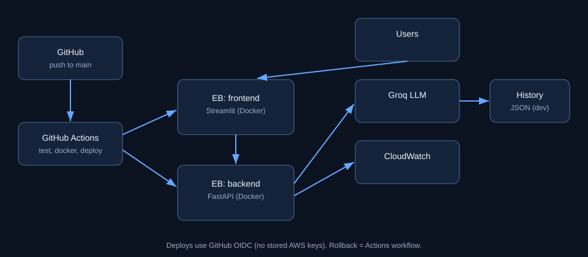

# DeployGuard

AI-assisted deployment risk and rollback helper, built for the **Build on Elastic Beanstalk Hackathon by TrainWithShubham**.

Give it error rate, latency and health. A deterministic engine scores the release (LOW / MEDIUM / HIGH), then an LLM explains what to investigate and whether to consider a rollback. The AI is advisory only.



## Features
- **Incident Lab**: one click breaks a demo route, measures the real damage, scores it, asks the AI for a structured verdict (OK / INVESTIGATE / ROLLBACK) and links to the rollback workflow. The fault auto-reverts after 2 minutes.
- Risk scoring (deterministic, tested) and AI diagnosis (Groq, advisory)
- **Live Monitor**: the service measures its own traffic (requests, 5xx rate, p90 latency) and can score it; optional AWS CloudWatch source
- Persistent history in **DynamoDB** (falls back to a local JSON file when no table is set)
- `/version` shows the deployed commit, so a rollback is visible
- JSON access logs with request ids, basic security headers, rate-limited `/diagnose`
- Container runs as a non-root user with a health check

## Stack
FastAPI + a single HTML dashboard (served by FastAPI) in one Docker container on AWS Elastic Beanstalk. GitHub Actions: lint + tests -> Docker build and health check -> Terraform validate -> keyless (OIDC) deploy with smoke tests. Rollback is a separate workflow. Infrastructure as code in `terraform/`.

## Pipeline
`.github/workflows/ci-cd.yml`: **test** (ruff + pytest), **docker-build**, **terraform-validate**, **deploy** (needs repo variable `AWS_ROLE_ARN`; uses the GitHub Environment `production`, where you can require approvals). Each deploy is an immutable version labelled with the commit, health-checked, then smoke-tested (`/health`, dashboard page, `/analyze`). **Rollback** workflow lists versions and redeploys the one you choose. Dependabot keeps actions, pip and Docker up to date.

## Status (what is verified)
| Item | Status |
|---|---|
| Risk scoring, API, telemetry, Incident Lab, history (file and DynamoDB via moto), headers | 29 automated tests |
| Lint, workflow and shell script checks | ruff, actionlint, shellcheck |
| Docker image and container health | CI on every push |
| Dashboard (all tabs) | exercised in jsdom against the real API; real-browser check is yours |
| Deploy via pipeline, DynamoDB on real AWS, Terraform apply, live CloudWatch data | verify using the guide (not tested by the author on a real account) |

See `docs/DEMO_SCRIPT.md` for a 2-minute demo script.

## Run locally
```
python -m venv .venv
.venv\Scripts\activate
pip install -r requirements-dev.txt
copy .env.example .env      # edit; never commit .env
uvicorn app.main:app --reload
```
Dashboard http://127.0.0.1:8000, API docs http://127.0.0.1:8000/docs. Or `docker compose up --build`.

## Demo (GitHub Pages)
Settings -> Pages -> Deploy from a branch (main, root) serves the root `index.html` (copy of `app/static/index.html`). It runs in demo mode: scoring in the browser, no AI, no telemetry. After editing the dashboard: `copy app\static\index.html index.html`.

## Known limitations
- Single instance over plain HTTP (HTTPS needs a domain, ACM certificate and a load balancer).
- No login on the dashboard.
- Telemetry is in-memory per instance and resets on restart.
- Risk weights are simple heuristics.
